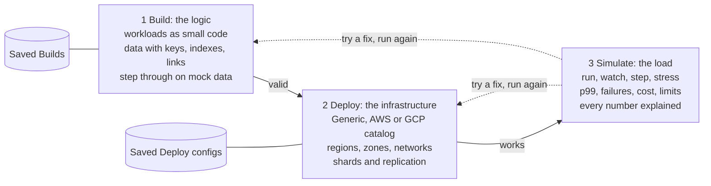
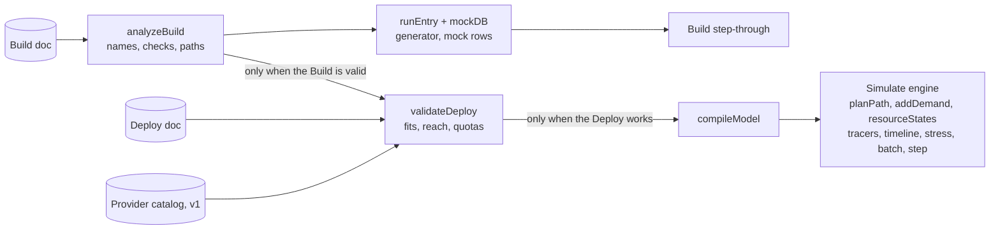
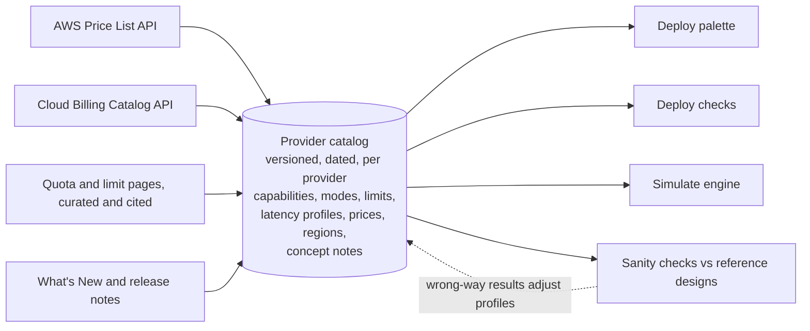
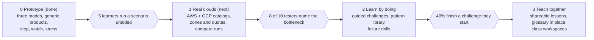

# Loadbearing — Design Doc

Oct 30, 2026 · exported from the Loadbearing — Design Doc (Claude Docs). Diagrams are rendered here as Mermaid.

Loadbearing is a sandbox for learning system design by experiment. You write a system's logic, map it onto realistic cloud infrastructure, and watch how it behaves at scale: where it slows, what fails first, and why. It exists to build understanding of architectures, not to certify a real implementation before it ships. This one doc holds the product definition and the technical design; it replaces the separate PRD, technical design and parity research docs.

## 1. Purpose

System design is mostly learned secondhand, from books, diagrams and interview prep. Learners read that a cache helps or that a second region adds latency, but rarely get to watch a design behave under load, because doing that for real means building it, running it at scale and paying for it. Loadbearing makes that experiment cheap: change one thing, run it again, see why the result moved.

**Goals**

1. **Build intuition for how architectures behave at scale.** Latency, throughput, bottlenecks, backlogs, failures and cost should respond to design choices the way they do in real systems, closely enough that the lesson is true.
2. **Explain every result.** Each number traces back to a step, a resource and a stated assumption, so a learner can answer "why" and not just read a score.
3. **Make exploration safe and fast.** Anything can be tried, undone and compared; nothing costs money or breaks anything.
4. **Teach with real vocabulary.** Deploy uses the products, limits and network shapes that AWS and GCP actually offer, so what a learner explores transfers to real conversations and interviews.
5. **Need no course to start.** Everything added gets working defaults; examples and guided challenges show the way in.

**Principles**

- Logic and infrastructure stay separate. A Build never names a product; a Deploy never changes the logic. That separation is the main thing Loadbearing teaches.
- Show the mechanism, not just the outcome: step-through, playback and per-step explanations are core features, not extras.
- Directionally right beats falsely precise. The model is tuned so comparisons between designs are trustworthy; absolute numbers are labeled as approximate.

**Non-goals**

- Validating, load-testing or certifying a specific production system before deployment.
- Capacity planning or cost quotes for a real budget. Prices are list-price estimates for comparison.
- Generating deployable infrastructure (Terraform, CloudFormation).
- Packet-level or discrete-event accuracy.

## 2. Who it's for and what they learn

The primary user is an engineer growing into system design: they know how to write a service and want to understand what happens when it meets real scale.

| User | Why they come | What they should leave understanding |
| --- | --- | --- |
| Engineer growing into system design | Build intuition they can't get from reading | Why a design slows, where its limit is, what each fix trades away |
| Candidate preparing for system design interviews | Practice explaining trade-offs with numbers | How to size, partition, replicate and justify a design out loud |
| Student or bootcamp learner | Learn distributed systems concepts hands-on | Queueing, consistency, replication, partitioning, back-pressure |
| Educator, mentor or tech lead | Teach a concept to a group | A shared example people can change and re-run together |
| Curious senior engineer | Explore a product or pattern they haven't used | How a new product (say, Aurora DSQL or Spanner) changes a design |

**Concepts a learner should be able to see in action** (each is something Loadbearing must make visible, not just mention):

- latency adds up along a path; distance between regions is a floor no tuning removes
- utilization drives queueing: waits grow sharply past about 80% busy
- the first thing to fill up sets the limit; fixing it reveals the next one
- indexes and partition keys decide whether a lookup is cheap or a scan
- replication buys reads and resilience, and costs write latency or consistency
- asynchronous work smooths spikes but can fall behind (backlog)
- autoscaling lags; cold starts and quotas are real limits
- losing a zone or region tests headroom, not just correctness

## 3. How it works

Three modes run in order, and each unlocks the next. The learning loop is the dashed line: see a result, try a change upstream, run again, compare.



- **Build** holds the logic: workloads written in a tiny language (`when Checkout { call CartService.GetCart; insert Checkouts; publish OrderEvents }`) and data nodes with fields, keys, indexes and links. Edges on the canvas are drawn from the code. Any handler can be stepped through on generated mock data.
- **Deploy** maps that logic onto infrastructure: compute, stores, regions, zones, load balancers, gateways, NAT, private endpoints, shards and replication. It checks that every workload and data node has a home and every connection can be made, with one-click fixes.
- **Simulate** runs scenarios against one Build on one Deploy: the busiest moment, a playback over time with failures, one request stepped across the infrastructure, and a ramp to find the breaking point.

Builds and Deploy configs are saved separately, so a learner can try the same logic on a single-region monolith and on a multi-region design, then compare.

## 4. Learning features

The proof of concept already teaches by showing mechanism (step-through, playback, explained waits). v1 adds structure around it so a learner knows what to try next.

| ID | Feature | What the learner does | Priority | In POC |
| --- | --- | --- | --- | --- |
| L1 | **Explain every number** | Click any latency, failure or cost and see the steps, resources and assumptions behind it | P0 | Mostly (per-step reasons, "what limits it") |
| L2 | **Guided challenges** | Start from a broken or naive design with a goal ("survive losing us-east-1b with under 1% failures for under $15/h") and fix it; the app checks the goal and shows hints on request | P0 | No |
| L3 | **Pattern library** | Open classic architectures as ready Builds and Deploys: cache-aside, outbox, fan-out on write vs. read, CQRS, sharded counters, saga, leader-follower vs. consensus | P0 | One example (checkout) |
| L4 | **What-if experiments** | Change one setting and see before and after side by side, with the difference explained ("p99 fell 210 ms because reads now stay in eu-west-1") | P0 | No (manual re-run only) |
| L5 | **Concept glossary in place** | Hover a term (quorum, back-pressure, hot partition) for a short explanation and a link to where it is happening in this design | P1 | No |
| L6 | **Failure drills** | Inject zone loss, region loss, a slow dependency or a cold cache during playback and watch the system respond | P1 | No |
| L7 | **Assumptions page** | See and change every constant the model uses, so a learner can ask "what if disks were twice as fast?" | P1 | No |
| L8 | **Share a lesson** | An educator shares a Build, Deploy, scenario and challenge as one link that opens read-only with "make a copy" | P1 | Partial (library, export) |
| L9 | **Back-of-envelope mode** | Estimate p99 or max throughput before running, then compare the guess to the result | P2 | No |

Challenges are data, not code: a challenge is a starting Build and Deploy, a scenario, a goal expression over results (p99, error rate, cost, backlog, availability under a failure), optional constraints ("Deploy only", "no new regions"), and ordered hints.

## 5. Requirements by mode

"POC" marks what the HTML proof of concept already does. P0 = needed for v1, P1 = v1 if time allows, P2 = later.

**Build**

| ID | Requirement | Priority | POC |
| --- | --- | --- | --- |
| B1 | Workloads hold code: `when` handlers (request, `message`, `file`, `schedule`, `change`), `call`, `read`/`insert`/`update`/`upsert`/`delete` with `by` and `many`, `publish`, `if Cond @p%`, `for each … ~N parallel N`, `parallel { }`, `compute Nms`, `error`, `return` | P0 | Yes |
| B2 | Canvas edges are drawn from the code, never by hand | P0 | Yes |
| B3 | Data kinds: table, documents, key-value, queue, event stream, pub/sub topic, files, objects; fields, key, indexes, "points to" links, volume | P0 | Yes |
| B4 | Unusual but possible operations (publish to a table as an outbox, read a queue) are warnings, not errors | P0 | Yes |
| B5 | Live checks with line numbers and one-click fixes (index a field) | P0 | Yes |
| B6 | Step through any handler on linked mock data: animated canvas, current line, call stack, request context, rows read and written, loop counters, branch choice (ask / odds / likelier) | P0 | Yes |
| B7 | Code suggestions; drag from a handler to a node to add a statement | P1 | Yes |
| B8 | Retries, timeouts and idempotency in the language | P1 | No |
| B9 | Caching as logic (`read Products via cache ttl 60s`), independent of the cache product | P1 | No |
| B10 | Transactions and consistency needs that Deploy must satisfy | P1 | No |
| B11 | Step `parallel` branches side by side | P2 | No |

**Deploy**

| ID | Requirement | Priority | POC |
| --- | --- | --- | --- |
| D1 | Many workloads per compute, many data nodes per store; drag chips between boxes; unfit drops refused, "works but not ideal" drops warned | P0 | Yes |
| D2 | Regions as large boxes with tiers: entry, private network (compute, private stores, NAT, endpoints), managed services, outside services | P0 | Yes |
| D3 | Network products per region (load balancer, API gateway with a limit, NAT, private endpoints), DNS steering, region links | P0 | Yes |
| D4 | Reachability and network checks with one-click fixes | P0 | Yes |
| D5 | Shards and "split by" per data node; fan-out warnings; Kafka partitions and stream keys | P0 | Yes |
| D6 | Replication modes: one region, primary + read copies, writable everywhere, majority vote, object copies | P0 | Yes |
| D7 | Provider catalogs (Generic, AWS, GCP) with real products, modes, editions, limits and list prices | P0 | No |
| D8 | Availability zones: subnets per zone, zonal vs. regional NAT, zone placement | P0 | No |
| D9 | Provider quotas enforced as checks, with "what if the quota were raised" | P0 | No |
| D10 | Provider-specific entry and connectivity products (ALB/NLB, Global Accelerator, GCP global load balancers, Transit Gateway, PSC, NCC); CDN and WAF | P1 | No |
| D11 | Hot keys and skew per partition key | P1 | No |
| D12 | Convert a Deploy between providers, listing what has no equal | P2 | No |

**Simulate**

| ID | Requirement | Priority | POC |
| --- | --- | --- | --- |
| S1 | Scenarios: an entry point plus requests over time (steady, peak, ramp past capacity), a file of N rows, or a scheduled run; users spread across world regions | P0 | Yes |
| S2 | Branch odds per scenario, defaulting to the `@%` in code | P0 | Yes |
| S3 | Busiest-moment run: p50, p99, failures, expected errors, cost per hour, what limits it, per path and per user region | P0 | Yes |
| S4 | Watch it run: playback over time with autoscaling lag, backlogs, live heat, flowing requests, event timeline | P0 | Yes |
| S5 | Step one request across the infrastructure with a clock and explained waits, at quiet, scenario or playback-moment load | P0 | Yes |
| S6 | Find max throughput and what fills up in order | P0 | Yes |
| S7 | Batch runs report finish time, the limiting factor and function timeouts | P0 | Yes |
| S8 | Compare runs side by side (two Deploys, or before/after a change) | P0 | No |
| S9 | Mixed traffic: several entry points sharing resources | P1 | No |

**Cross-cutting**

| ID | Requirement | Priority | POC |
| --- | --- | --- | --- |
| X1 | Builds and Deploys saved, loaded, exported and imported separately | P0 | Yes |
| X2 | Undo and redo for every edit; toasts with Undo on destructive actions | P0 | Yes |
| X3 | Mode gating with the reason shown | P0 | Yes |
| X4 | Light and dark themes; usable at 400 px; keyboard shortcuts for stepping | P0 | Yes |
| X5 | WCAG 2.2 AA; non-color cues for heat and status; touch alternative to drag | P1 | Partial |

## 6. Success metrics

Measured 90 days after public launch. They track learning and exploration, not production readiness.

| Metric | Target | What it tells us |
| --- | --- | --- |
| New users who run a scenario in their first session | 60% | Defaults and examples get people to a result |
| Sessions that change something and re-run at least 3 times | 50% | People are experimenting, not just reading |
| Builds tried on 2 or more Deploy configs | 35% | People compare designs, the core lesson |
| Learners who finish a guided challenge they start | 40% | Challenges are pitched at the right level |
| Testers who correctly name the bottleneck and why, after a run | 8 of 10 in usability sessions | Explanations work |
| Comparisons that point the right way against published case studies and measured reference designs | 9 of 10 | The model teaches true intuitions |

## 7. Architecture

Loadbearing runs entirely in the browser as a pipeline of pure functions. Any edit re-runs everything downstream in milliseconds, and any result can be reproduced from the two documents plus a random seed, which is what makes "change one thing and compare" trustworthy.



The analysis feeds both the step-through (which runs the code) and Deploy validation (which needs every call and data operation). Simulate only ever sees the compiled model.

## 8. Documents: Build and Deploy

Two document types, saved and versioned separately. A Build never references a Deploy. A Deploy refers to Build names (workloads, data) by string, so one Deploy can be reused across Builds that share names; validation reports any that don't exist. Example files ship in the starter kit under `examples/`.

**Build** (`kind: "loadbearing-build"`)

```json
{
  "kind": "loadbearing-build", "v": 1, "id": "b-checkout", "name": "Checkout system",
  "workloads": [
    { "id": "w1", "name": "Storefront", "x": 20, "y": 60, "external": false,
      "code": "when Checkout {\n  call CartService.GetCart\n  if CartIsEmpty @4% {\n    error 400\n  }\n  ...\n}" }
  ],
  "data": [
    { "id": "d4", "name": "Checkouts", "kind": "table", "x": 830, "y": 20, "rows": 4e8, "rowKB": 1.5,
      "partitionKey": null,
      "fields": [ { "name": "checkout_id", "type": "uuid", "key": true },
                  { "name": "customer_id", "type": "uuid", "index": true, "ref": "Customers.customer_id" } ] }
  ],
  "scenarios": [
    { "id": "sc1", "name": "Checkout rush", "entry": "Storefront.Checkout",
      "count": 360000, "durationMin": 60, "burst": "steady|peak|ramp",
      "origins": { "na": 50, "eu": 30, "asia": 20 },
      "odds": { "Storefront.Checkout: CartIsEmpty": 0.04 }, "goalMs": 800 },
    { "id": "sc3", "name": "Product feed import", "entry": "ProductImport.file ProductFeeds",
      "rows": 1000000, "goalMin": 30 }
  ]
}
```

Data kinds: `table`, `document`, `kv`, `queue`, `stream`, `topic`, `file`, `blob`. Scenarios live in the Build because their entry points and branch names come from its code. An entry key is `Workload.Handler`, where a triggered handler's name includes its trigger (`message OrderEvents`).

**Deploy** (`kind: "loadbearing-deploy"`) — the POC shape; lines marked v1 are planned

```json
{
  "kind": "loadbearing-deploy", "v": 1, "id": "dp-global", "name": "Global services",
  "provider": "generic",                 // v1: "aws" | "gcp" | "generic"
  "catalog": "aws@2026-10-29",            // v1: catalog version used
  "regions": ["use1", "euw1", "apse1"],
  "zones": { "use1": ["a", "b", "c"] },   // v1
  "peering": true,
  "network": {
    "link": "peering|transit", "steering": "nearest|primary",
    "regions": { "use1": { "entry": "lb|apigw|none", "limit": 10000, "nat": true, "endpoints": false } }
  },
  "externals": { "PaymentGateway": { "region": "use1" } },
  "compute": [
    { "id": "c1", "name": "edge-cluster", "type": "k8s|vm|fn|ctr", "product": "eks",   // product: v1
      "regions": ["use1", "euw1"], "size": "Medium", "min": 3, "max": 40,
      "concurrency": 1000, "memory": 1024, "vpc": true,
      "workloads": ["Storefront", "CartService"] }
  ],
  "stores": [
    { "id": "s1", "name": "orders-db", "type": "postgres|distsql|kv|doc|redis|kafka|queue|pubsub|objects",
      "product": "aurora-dsql", "witness": "use2",                           // v1
      "regions": ["use1", "euw1"], "primary": "use1",
      "repl": "single|read-replicas|multi-primary|consensus|crr", "readFrom": "nearest|primary",
      "size": "Small|Medium|Large", "shards": 1, "partitions": 12,
      "dataCfg": { "Checkouts": { "pk": "checkout_id" } },
      "data": ["Checkouts", "Shipments"] }
  ]
}
```

`normalizeDeploy()` fills defaults for older documents (network per region, `shards: 1`, `dataCfg`). Documents saved under the old name (`meridian-build`, `meridian-deploy`) load and are upgraded. Each future version bump gets a migration function; loading never fails on a missing optional field.

## 9. The workload language

The language is deliberately tiny: it says what a handler touches and in what order, not how. That keeps the lesson on architecture rather than programming. A line-based parser (`parseCode`) builds a statement tree; `analyzeBuild` resolves names across the whole Build.

```text
handler   := "when" trigger "{" stmt* "}"
trigger   := Name | "message" Data | "file" Data | "change" Data | "schedule" STRING
stmt      := "call" Workload "." Handler
           | op Data [("by" | "where") field] ["many" N]      op := read|insert|update|upsert|delete
           | "publish" Data
           | "if" Cond ["@" P "%"] "{" stmt* "}" ["else" ("{" stmt* "}" | if)]
           | "for each" item "in" (Source | "file") ["~" N] ["parallel" N] "{" stmt* "}"
           | "parallel" "{" stmt* "}"
           | "compute" N "ms" | "error" code | "return"
N         := number with k/M/B suffixes ("120k"); comments start with # or //
```

**Analysis** (`analyzeBuild`) returns resolved workloads and data, every `call` edge, data operations grouped by workload and data node, triggers, field references, entry points, and problems (severity, node id, line).

- An entry point is any handler with a trigger, or any request handler no other handler calls.
- Operations are checked against `DATA_KINDS[kind].ops` (allowed) and `.soft` (allowed with a warning, such as publishing to a table as an outbox). Anything else is an error with a suggestion.
- A lookup `by` a field that is neither the key nor indexed is a scan warning with an "index it" fix.

**Path enumeration** (`enumeratePaths(A, entry, odds)`) walks the handler and every callee, forking at each `if`. Each path is a flat list of steps (`enter`, `call`, `ret`, `data`, `publish`, `compute`, `error`) with a probability, a loop multiplier and parallel-group markers. Loop bodies are emitted once with `mult = N`. An `error` ends the path; `return` ends only the current handler. Paths are capped at 128 per entry and cached per (entry, odds). Labels list only the branches taken ("Payment declined → error 402").

## 10. Step-through interpreter and mock data

Stepping runs the real statement tree, not the enumerated paths, so loops iterate and branches are decided live. `runEntry(A, build, db, key, opts)` is a JavaScript generator that yields one event per statement and pauses at each `if` to receive the answer.

| Event | Emitted when | Carries |
| --- | --- | --- |
| `start`, `done` | A run begins or ends | trigger type, outcome |
| `enter`, `exit` | A handler starts or finishes | workload, handler, depth |
| `call`, `back` | A call leaves or returns | caller, callee, outcome |
| `data` | A read or write runs on the mock tables | op, rows, before/after for updates, scan flag, note when nothing matches |
| `publish` | A message is added to a queue, stream or topic | the message, its consumers, queue depth |
| `ask` → `branch` | An `if` is reached, then decided | condition, default odds, who decided (you, odds, likelier side) |
| `iter`, `loopend` | A loop iteration starts, the loop ends | i of n, items shown, parallelism |
| `compute`, `error`, `return`, `par` | The statement of that name | duration, code |

- **Mock data.** `mockDB(build, seed)` fills each table with 6 rows, files with 5, objects with 1, and message stores with none. Tables fill in dependency order so a "points to" field takes a real id from its target; a JSON `items` field holds real product ids. Values come from field names and types. A seeded PRNG makes runs repeatable.
- **Request context.** Reads copy the row's key, references and list fields into the context; inserts add the new key. Later statements look rows up by those values. A read by a known value that matches nothing returns nothing, often exactly the bug a learner is hunting.
- **Loops.** A `for each` over a list in the context walks that list; a file loop walks the file's rows. Up to 6 iterations are shown and the rest summarized; context changes inside an iteration are rolled back after it.
- **Stepping back.** Every visible event stores a copy of the context and of the table it touched, so Back is a pointer move. After a run that published, the learner can run each consumer on the actual message.

## 11. Deploy validation and the provider catalog

`validateDeploy(build, analysis, deploy)` returns problems, each with a severity, a location and an optional `fix`: a function that mutates a copy of the Deploy and is applied through the normal commit, so every fix is undoable. Checks run in this order:

1. **Regions:** every compute and store sits only in the Deploy's regions.
2. **Placement:** every non-external workload on exactly one compute; every data node in exactly one store.
3. **Fit:** `storeFit(product, dataKind)` returns native, works (a warning with a note) or no (an error). Key-value in PostgreSQL works; a table in Kafka does not.
4. **Replication:** the mode is one the product supports; one-region products aren't spread across regions; majority vote warns under 3 regions.
5. **Reachability:** for every call and data operation, from every region the caller runs in, to the copy it would use (`storeTarget` picks it from the replication mode and read preference). Private targets need private-network compute; cross-region private traffic needs linked networks.
6. **Network products:** public entry points on private compute need a load balancer or API gateway; private compute calling outside needs NAT; private compute using public managed stores needs NAT or private endpoints.
7. **Partitioning:** with more than one shard, reads by a field other than the split field are flagged as fan-out reads, with a fix to change the split.
8. **Advisories:** cross-store references; functions running file or schedule handlers (15-minute limit).

**v1: a provider catalog replaces hard-coded tables.** Today `COMPUTE`, `STORES` and `NET` are constants in `infra.js`. In v1 they become versioned data loaded at startup. Parity with the clouds then becomes a data task, and catalog entries double as teaching material.



A Build never names a product; Deploy maps three layers: the **capability** the code needs ("a table read by key, written in two regions, consistent"), a **product** that satisfies it (DynamoDB global tables in strong mode, Aurora DSQL, Spanner Enterprise Plus), and that product's **settings** (regions, witness, edition, size, shards).

```json
{
  "provider": "aws", "version": "2026-10-29",
  "products": [{
    "id": "dynamodb", "label": "DynamoDB", "category": "store", "status": "ga",
    "fits": { "kv": "native", "document": "native",
              "table": ["works", "Only key lookups are cheap; other fields need a GSI."] },
    "net": "public", "partitioning": "auto",
    "modes": { "global-eventual": { "repl": "multi-primary" },
               "global-strong":   { "repl": "consensus", "regions": ["us-east-1", "us-east-2", "us-west-2"] } },
    "latency": { "read": [3, 10], "write": [5, 16] },
    "limits": [{ "id": "item-size", "value": 400, "unit": "KB", "raisable": false, "source": "<url>" }],
    "pricing": { "source": "price-list-api", "fetched": "2026-10-29" },
    "concepts": ["partition key", "global secondary index", "last writer wins"],
    "regions": "*"
  }]
}
```

- A `limits` entry compiles to a check, so adding a quota never needs code.
- `modes` restrict settings: a mode limits the regions offered and the replication shown.
- `concepts` link a product to glossary entries (L5).
- The Generic catalog is today's tables in this format, so current Deploys load unchanged.
- Network rules read the network scope from the catalog: on GCP a VPC is global and subnets are regional, so cross-region private traffic inside one VPC needs no link.

## 12. Simulation engine

The engine is analytic where it can be and Monte Carlo where shapes matter. It aims for comparisons that point the right way and magnitudes in the right range, not exact predictions. A busiest-moment run (1,500 sampled requests) takes about 30–60 ms; a 48-moment playback about 150–200 ms in the browser.

1. **Plan.** `planPath(model, path, startRegion)` turns path steps into located segments: `cpu` on a compute in a region; `net` hops (in-process 0.05 ms, same region 0.8 ms, cross-region by distance, +2 ms through NAT, +0.3 ms through private endpoints); `data` (target copy from the replication mode, quorum delay for consensus writes, scan and shard fan-out flags); `pub`; `ext` (outside service time); `err`. Segments record the boxes they move between, which drives animation.
2. **Distance.** Round trips between regions use great-circle distance at 200 km/ms in fiber with a 1.35 routing factor. Users add 8 ms of last mile; consensus writes wait for the k-th nearest voter.
3. **Demand.** For arrival rate λ, `addDemand` sums per resource: CPU-ms/s per compute per region; store ops/s per copy (reads 1 + rows/50, scans rows/400, writes 2, fan-out reads × shards); messages/s; connections wanted; gateway and NAT requests. Publishing adds consumers' demand recursively (depth 3).
4. **Resource state.** Compute scales to the instances needed at 60% target CPU, clamped to min/max. Utilization ρ per resource: CPU, store ops over capacity × shards, partition throughput, gateway rate over limit, NAT connections over 50,000, connections wanted over the store limit × shards.
5. **Latency under load.** Each sampled request walks its plan with lognormal step times. CPU waits use the Sakasegawa M/M/c approximation; store latency is inflated by 1 + 0.5ρ³/(1−ρ) and by 1 + 0.35 log₂(shards) for fan-out. Above ρ = 0.97, requests fail with probability 1 − 0.97/ρ and the reason is recorded. Cold starts apply to functions and scale-to-zero containers. Log-binned histograms give p50/p95/p99 without sorting.
6. **Batch runs.** File and schedule handlers finish at the larger of the latency-bound time (rows in sequence, divided by declared parallelism) and each resource's capacity-bound time; functions past 15 minutes report a timeout and rows completed.
7. **Max throughput.** `capacityLambda` finds the λ where each resource hits 97%, then 9 points from 5% to 125% of the first limit draw the curve.
8. **Playback.** `simulateTimeline` evaluates 48 moments with a load shape (steady, peak at 3×, ramp to 135% of capacity). Instances grow per minute at 60% (Kubernetes), 250% (containers) or 15% (VMs) of current size, so overload during scale-out is visible. Backlogs integrate arrivals minus consumer capacity. Threshold crossings become timeline events.
9. **One request, step by step.** `stepRequest` replays one path at median timings against a chosen load and splits each step into service time and waiting time, with a sentence explaining both.

```latex
W_q \approx \frac{s\,\rho^{\sqrt{2(c+1)}-1}}{c\,(1-\rho)} \qquad \mathrm{RTT}_{ms} = \frac{2d_{km}}{200} \times 1.35 + 4
```

**Known simplifications**, to be listed on the Assumptions page (L7): no retries or timeouts yet; no zone failures yet; resources independent except shared compute; uniform keys (no hot partitions); fixed latency profiles per product.

## 13. UI architecture

The proof of concept is one HTML file of plain JavaScript with no framework and no dependencies, about 3,000 lines across 13 source modules concatenated by `build.sh`. That keeps it portable and quick to iterate on. v1 should move to TypeScript and a component framework once the data model settles, porting module by module behind the same function signatures (engine first, UI last).

**State and commits.** One state object `ST` holds the open Build, Deploy, selections and view modes. Every edit goes through `commit(mutate)`: snapshot for undo, mutate, re-run analysis and validation, autosave, re-render (or a `partial` re-render). Code edits re-analyze after a 260 ms pause.

**Events.** Elements declare intent with `data-act` (click), `data-ch` (change) and `data-in` (input); three document-level listeners dispatch to the `ACT`, `CH` and `IN` tables. This survives full re-renders without rebinding. `data-fb` marks regions for the comment mode.

**The infra board.** Region boxes and their tiers are laid out by CSS flexbox. After layout, `wireBoard` measures every `[data-box]` and draws wires into an SVG layer underneath and labels into one above; hover or selection re-wires with focus. Box keys: `c:<computeId>@<region>`, `s:<storeId>@<region>`, `e:<region>` (entry), `n:<region>` (NAT), `x:<workload>` (outside), `u:<pop>` (users). Placement uses HTML5 drag-and-drop (`data-drag`, `data-drop`) with a fit check on `dragover`.

**Animation.** Build stepping moves a dot along a curve between node rectangles. Simulate playback spawns particles per link at a rate proportional to log(flow), moving along hidden SVG paths with `getPointAtLength`, capped at 220. Heat, instance counts and the event feed update in place each frame.

**Accessibility.** Modes, nodes and boxes are focusable with labels; heat shows percentages as text as well as color; stepping has keyboard shortcuts (← → space, Y/N). Gap: canvas movement and drag placement need a pointer (the inspector is the alternative).

## 14. Cloud coverage

Deploy should let a learner explore designs with the products AWS and GCP offer today, because those are the trade-offs they will discuss at work and in interviews. The POC has 4 generic compute types and 9 generic stores; this table lists what the v1 catalogs must add and the concept each one teaches. Facts were checked on October 29, 2026.

| Role | AWS | Google Cloud | What it teaches | POC today |
| --- | --- | --- | --- | --- |
| Functions | Lambda: [1,000 concurrent per region by default, +1,000 environments per 10 s, 15-minute timeout](https://docs.aws.amazon.com/lambda/latest/dg/gettingstarted-limits.html) | Cloud Run functions | Cold starts, concurrency quotas, burst scaling | Generic functions |
| Functions with many requests per environment | [Lambda Managed Instances](https://aws.amazon.com/blogs/compute/serverless-icymi-q4-2025), [Lambda Web Functions](https://aws.amazon.com/about-aws/whats-new/2026/10/aws-lambda-web-functions/) (Oct 2026) | [Cloud Run: up to 1,000 concurrent requests per instance, 60-minute requests](https://docs.cloud.google.com/run/quotas) | Why per-request instances cost more under load | Missing |
| Containers and workers | ECS (Fargate, Managed Instances, Express Mode), EKS | Cloud Run services, jobs, worker pools; GKE | Autoscaling lag, always-on vs. scale-to-zero | Kubernetes, VMs, containers (generic) |
| Durable and isolated execution | [Lambda durable functions](https://aws.amazon.com/blogs/compute/serverless-icymi-q4-2025), Step Functions, [Lambda MicroVMs](https://aws.amazon.com/about-aws/whats-new/2026/06/aws-lambda-microvms/) | Workflows | Long-running work without paying for waits | Missing |
| Distributed SQL | [Aurora DSQL: two writable regions + witness, 99.999%](https://aws.amazon.com/blogs/aws/amazon-aurora-dsql-is-now-generally-available) | [Spanner: multi-region and geo-partitioning need Enterprise Plus](https://docs.cloud.google.com/spanner/docs/editions-overview) | Consensus, witness regions, write latency vs. consistency | Generic majority vote |
| Key-value | DynamoDB; [global tables with strong consistency, RPO zero](https://aws.amazon.com/about-aws/whats-new/2025/06/amazon-dynamo-db-global-tables-multi-region-strong-consistency-generally-available/) | Bigtable, Firestore | Partition keys, secondary index cost, eventual vs. strong | Generic key-value |
| Relational, one writer | RDS, Aurora ([Serverless v2 scales to 0](https://aws.amazon.com/about-aws/whats-new/2024/11/amazon-aurora-serverless-v2-scaling-zero-capacity)) | Cloud SQL, AlloyDB | Connection limits, read replicas, failover | Generic PostgreSQL |
| In-memory | ElastiCache (Valkey), MemoryDB | [Memorystore for Valkey 9.0](https://cloud.google.com/blog/products/databases/whats-new-for-google-cloud-databases-at-next26) | Cache hit ratio, eviction, what a cold cache does | Generic Redis |
| Streams and queues | MSK ([Express brokers](https://aws.amazon.com/msk/features/express-brokers-for-amazon-msk)), Kinesis, SQS ([fair queues](https://aws.amazon.com/about-aws/whats-new/2025/07/amazon-sqs-introduces-fair/)), SNS | [Managed Kafka (regional) and Pub/Sub (global, ordering keys)](https://docs.cloud.google.com/pubsub/docs/choose-pubsub-kafka?hl=it), Cloud Tasks | Ordering, partitions, backlog, noisy neighbors | Generic Kafka, queue, topic |
| Events and schedules | EventBridge (rules, Scheduler, Pipes) | Eventarc, Cloud Scheduler | Fan-out, delivery delay, retries | Implied by `when schedule` |
| Networks | VPC per region, subnets per AZ; peering, Transit Gateway, Cloud WAN, PrivateLink, VPC Lattice; [regional NAT gateway](https://aws.amazon.com/about-aws/whats-new/2025/11/aws-nat-gateway-regional-availability) | [Global VPC, regional subnets](https://docs.cloud.google.com/vpc/docs/vpc); Private Service Connect; NCC | Why network scope differs by cloud; egress paths | One network per region, no zones |
| Entry | ALB, NLB, Global Accelerator; [API Gateway: 10,000 req/s per account per region](https://docs.aws.amazon.com/us_en/apigateway/latest/developerguide/limits.html) | [Global external, regional and cross-region internal load balancers](https://docs.cloud.google.com/load-balancing/docs/load-balancing-overview) | Anycast vs. DNS steering, shared account limits | Generic LB / API gateway |
| Footprint | [39 regions, 124 AZs](https://aws.amazon.com/about-aws/global-infrastructure/regions_az/) | [43 regions, 130 zones](https://cloud.google.com/about/locations/) | Distance as a latency floor | 8 fixed regions |

The catalog keeps this current: prices refresh from the [AWS Price List API](https://docs.aws.amazon.com/awsaccountbilling/latest/aboutv2/price-changes.html) and the [Google Cloud Billing Catalog API](https://docs.cloud.google.com/billing/v1/how-tos/catalog-api); limits and new products are curated by hand with a source link, reviewed after re:Invent (December) and Google Cloud Next (April).

## 15. Roadmap and open questions



Each phase starts only when the gate before it is met. Phase 1 is the largest piece of engineering: the catalog format, availability zones, quota checks and side-by-side comparison (D7–D9, S8). Phase 2 turns the sandbox into a curriculum (L2, L3, L6).

**Build order for phase 1**

1. Catalog format and loader; Generic catalog rebuilt from today's tables (no behavior change).
2. Availability zones in the Deploy model, board (collapsed by default) and engine.
3. AWS catalog, first 20 products; GCP catalog, first 20 products, including GCP's global VPC rules.
4. Quota checks with "what if raised" toggles; multi-request function environments in the engine.
5. Compare runs side by side.

**Open questions**

- [ ] Free for individuals with a paid tier for educators and teams, or free throughout?
- [ ] Which 10 reference designs and published case studies do we use to sanity-check that comparisons point the right way?
- [ ] Should challenges be authored only by us at first, or by educators from day one?
- [ ] Keep simulation on the main thread, or move playback and stress to a Web Worker once catalogs and zones grow the model?
- [ ] Azure in phase 1, or only after AWS and GCP prove the catalog design?

## 16. Working on the code

The starter kit (`loadbearing-kit.zip`) holds everything a person or a coding agent needs to continue: this doc as `docs/DESIGN.md`, the proof of concept with source and tests, standalone mockups, example documents and a sample catalog entry. `AGENTS.md` at its root is the short version of this section.

| Path | What it is |
| --- | --- |
| `poc/loadbearing.html` | The built proof of concept. Open it in a browser; no server or install needed. |
| `poc/src/` | Source modules, concatenated in a fixed order by `poc/build.sh` |
| `poc/tests/engine.test.js` | Node tests for the language, interpreter, validation and simulation (no dependencies) |
| `poc/tests/ui.smoke.js` | Headless Chromium walk through all three modes; fails on any page error (needs Playwright) |
| `mockups/` | Standalone HTML of the 7 mockup screens, plus `index.html`; `mockups/source/` holds the canvas originals |
| `examples/` | The checkout Build and two Deploy configs as JSON |
| `catalog/` | A sample provider catalog entry in the v1 format |

| Module | Responsibility |
| --- | --- |
| `lang.js` | Parser, highlighter, `analyzeBuild`, path enumeration |
| `run.js` | Step-through interpreter and mock data |
| `infra.js` | Regions, products, network model, `validateDeploy`, auto-placement |
| `sim.js` | Planning, demand, resource state, tracers, stress, batch, playback, single-request stepping |
| `starter.js`, `map.js` | Example documents; world map dots and projection |
| `ui-core.js` | State, commit/undo, event delegation, library, comments |
| `ui-build.js`, `ui-debug.js` | Canvas, editor, suggestions, drag-to-connect; step-through |
| `ui-deploy.js` | Region board, wires, drag-and-drop, inspectors |
| `ui-sim.js`, `ui-play.js` | Scenarios, results, playback, particles, single-request stepping |

**Invariants to keep**

- Engine modules (`lang`, `run`, `infra`, `sim`) are pure: no DOM, no globals beyond their own constants, deterministic for a given seed.
- A Build never names a product; a Deploy never edits logic.
- Every edit goes through `commit()` so undo works; every Deploy fix is a function applied through it.
- Every number shown to a learner has an explanation path (a step, a resource, an assumption).
- Colors are CSS tokens with light and dark values; nothing depends on color alone.
- Every user-visible string is plain language; no internal ids in the UI.

**Build and test**

```text
cd poc && ./build.sh            # writes loadbearing.html and checks syntax
node tests/engine.test.js       # engine tests, no install
npx playwright install chromium && node tests/ui.smoke.js   # optional UI walk
```

## Sources

- [AWS Global Infrastructure: Regions and AZs](https://aws.amazon.com/about-aws/global-infrastructure/regions_az/) · [Google Cloud locations](https://cloud.google.com/about/locations/)
- [Serverless ICYMI Q4 2025](https://aws.amazon.com/blogs/compute/serverless-icymi-q4-2025) · [Lambda quotas](https://docs.aws.amazon.com/lambda/latest/dg/gettingstarted-limits.html) · [Lambda Web Functions](https://aws.amazon.com/about-aws/whats-new/2026/10/aws-lambda-web-functions/) · [Lambda MicroVMs](https://aws.amazon.com/about-aws/whats-new/2026/06/aws-lambda-microvms/)
- [Aurora DSQL GA](https://aws.amazon.com/blogs/aws/amazon-aurora-dsql-is-now-generally-available) · [DynamoDB multi-Region strong consistency](https://aws.amazon.com/about-aws/whats-new/2025/06/amazon-dynamo-db-global-tables-multi-region-strong-consistency-generally-available/) · [Aurora Serverless v2 to zero](https://aws.amazon.com/about-aws/whats-new/2024/11/amazon-aurora-serverless-v2-scaling-zero-capacity)
- [SQS fair queues](https://aws.amazon.com/about-aws/whats-new/2025/07/amazon-sqs-introduces-fair/) · [MSK Express brokers](https://aws.amazon.com/msk/features/express-brokers-for-amazon-msk) · [API Gateway quotas](https://docs.aws.amazon.com/us_en/apigateway/latest/developerguide/limits.html) · [Regional NAT gateway](https://aws.amazon.com/about-aws/whats-new/2025/11/aws-nat-gateway-regional-availability)
- [Google Cloud Next 2026 wrap-up](https://cloud.google.com/blog/topics/google-cloud-next/google-cloud-next-2026-wrap-up) · [Databases at Next '26](https://cloud.google.com/blog/products/databases/whats-new-for-google-cloud-databases-at-next26) · [Spanner editions](https://docs.cloud.google.com/spanner/docs/editions-overview) · [Cloud Run quotas](https://docs.cloud.google.com/run/quotas)
- [Pub/Sub vs. Managed Kafka](https://docs.cloud.google.com/pubsub/docs/choose-pubsub-kafka?hl=it) · [Cloud Load Balancing](https://docs.cloud.google.com/load-balancing/docs/load-balancing-overview) · [Google Cloud VPC](https://docs.cloud.google.com/vpc/docs/vpc)
- [AWS Price List API](https://docs.aws.amazon.com/awsaccountbilling/latest/aboutv2/price-changes.html) · [Cloud Billing Catalog API](https://docs.cloud.google.com/billing/v1/how-tos/catalog-api)
- Other simulators: [SysSimulator](https://syssimulator.com/), [paperdraw.dev](https://paperdraw.dev/)
